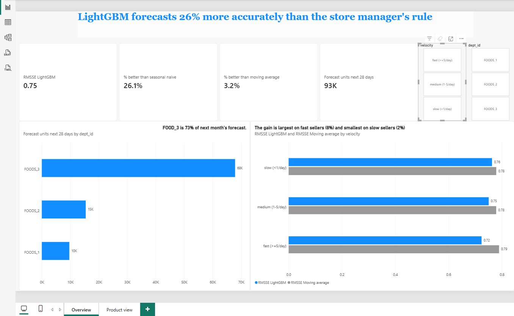
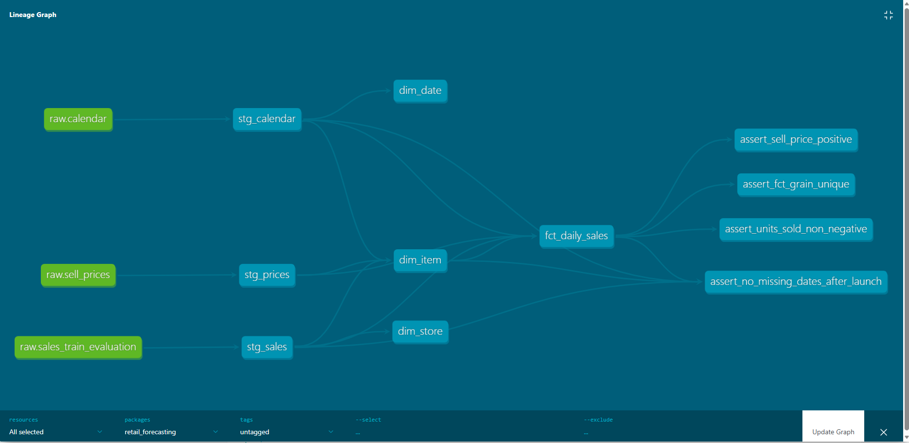
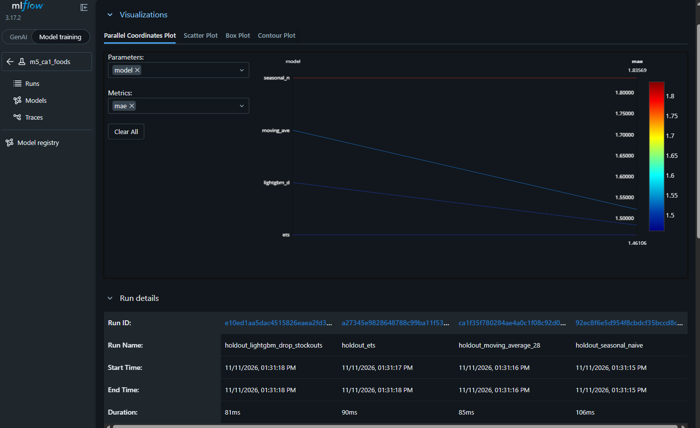
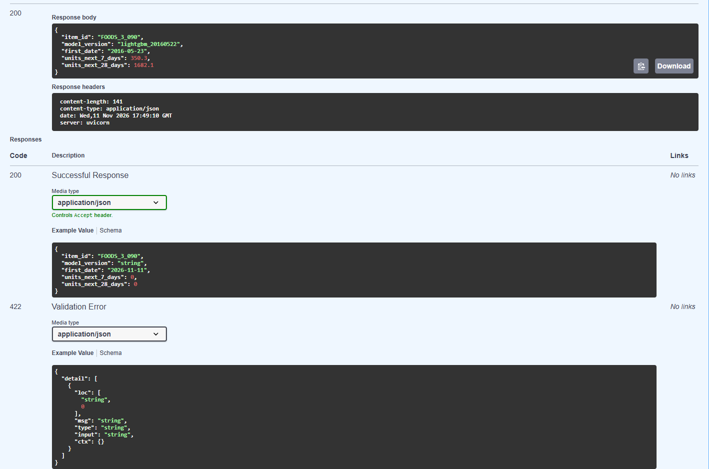
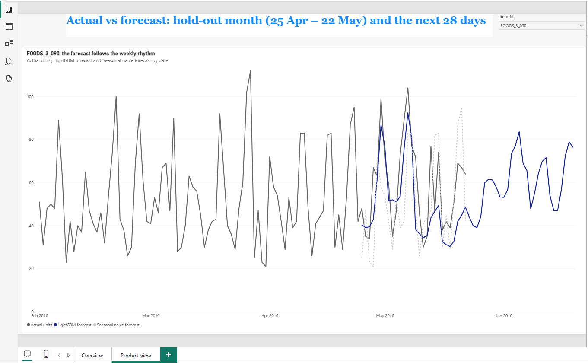

# Retail Demand Forecasting: From Raw Sales Data to a Deployed Forecast

**Business question:** How many units of each food product will one Walmart store sell over the next 28 days, and how much better is a machine learning model than a simple rule a store manager could use?

An end-to-end forecasting system on real Walmart data (M5, store CA_1, 1,437 food products, 5 years of daily sales). Raw CSVs are modelled into a tested **dbt** star schema in **DuckDB**, analysed to decide which features to build, and used to train a **LightGBM** model that is validated with rolling-origin cross-validation, tracked in **MLflow**, and compared against baselines and ETS. The final forecasts are written to a table, served by a **FastAPI** service in **Docker** with **pytest** tests and **GitHub Actions** CI, and shown in a **Power BI** dashboard. One command rebuilds everything from the raw files.

## Result

**LightGBM forecasts 26% more accurately than the store manager's rule** ("the next 4 weeks repeat the last 4") on a hold-out month it never saw, and 3.2% more accurately than a 28-day moving average (6.4% when products are weighted by sales value).

| Model | What it does | Hold-out RMSSE | Weighted RMSSE | MAE (units/day) | Bias | CV RMSSE |
|---|---|---|---|---|---|---|
| Seasonal naive | Repeats the last 4 weeks | 1.021 | 1.077 | 1.84 | −6.8% | 0.952 |
| Moving average | Average of the last 28 days | 0.779 | 0.826 | 1.52 | −6.8% | 0.717 |
| ETS | One statistical model per product | 0.766 | 0.797 | 1.46 | −6.7% | 0.713 |
| **LightGBM** | One machine-learning model for all products | **0.754** | **0.774** | **1.44** | −6.8% | **0.696** |

*RMSSE: error relative to each product's normal day-to-day variation, averaged over products (lower is better; M5 competition metric). Hold-out: 25 Apr – 22 May 2016, used once. CV: mean of three earlier 28-day windows. Sources: [`results/holdout_results.csv`](results/holdout_results.csv) (`python -m forecasting.final_eval`) and `python -m forecasting.train`.*

What the results mean, in [FINDINGS.md](FINDINGS.md):
- The gain is concentrated on fast sellers (8% better than the moving average) and small on slow, intermittent ones (1–2%).
- All models under-forecast the hold-out month by about 7%: sales started their summer rise, which no model anticipated.
- Tuning changed less than 0.5%. Further gains need better information (stock levels, yearly seasonality), not more tuning.



## Architecture

```
Raw CSVs ──► DuckDB (raw) ──► dbt star schema ──► Analysis (findings)
                                      │                  │ informs features
                                      ▼                  ▼
                               Feature table ──► ML (baseline → ETS → LightGBM)
                                                         │  MLflow tracking
                                                         ▼
                                Forecast table in DuckDB ◄── batch scoring
                                      │
                       ┌──────────────┴──────────────┐
                       ▼                             ▼
                FastAPI + Docker               Power BI dashboard
             (tested in GitHub Actions)     (actual vs forecast, errors)
```

`python run_pipeline.py` runs ingestion → `dbt build` (models + tests) → final training and batch scoring, and stops at the first failing step.

## How it was built

### 1. Data engineering: a tested star schema (dbt + DuckDB)
The raw CSVs are loaded unchanged; dbt filters the scope, unpivots daily sales from wide to long, and builds a star schema (`fct_daily_sales`, `dim_date`, `dim_item`, `dim_store`) plus the feature table. **30 dbt tests** check keys, relationships, non-negative sales, positive prices, no missing days, and that no feature uses data after its forecast date.

Key decision: a product's history starts at its **first price**, not its first sale. Zeros before launch are not real demand; zeros after launch are.



### 2. Analysis: findings that decide the features
Six verified findings ([FINDINGS.md](FINDINGS.md), [notebook](analysis/01_eda.ipynb)), each linked to a modelling decision: weekends sell 1.5× a midweek day; food-stamp (SNAP) days +13%; holidays matter by name, and the day before can matter more (+48% before Thanksgiving); price elasticity about −2.3; the typical product sells nothing on half its days; and **15% of the data looks like stockouts recorded as zero sales**.

### 3. Machine learning without look-ahead
- **Direct 28-day forecasts:** every feature is computed as of the forecast date (recent sales levels, same weekday in past weeks); calendar, events and prices of the target day are allowed because they are known in advance.
- **Rolling-origin cross-validation** (3 × 28 days) for all decisions, plus a final 28-day hold-out evaluated once. No early stopping on validation data.
- **LightGBM with a Tweedie objective** (counts with many zeros), one global model for all products. Baselines and ETS (statsforecast) as benchmarks.
- **Metrics:** MAE, RMSE, RMSSE, bias and value-weighted RMSSE, also on in-stock days only. Every run logged to **MLflow**.
- **Error analysis** by sales speed, demand pattern, department, day type and horizon, with significance tests.



### 4. Serving: batch scoring, API, tests, Docker, CI
- `forecasting.predict` retrains on all data and writes the next 28 days for every product to `serving.forecasts`. Training and forecast rows come from the same dbt model, so the deployed model cannot receive features computed differently (no training-serving skew).
- **FastAPI** reads that table: `/health`, `/forecast/{item_id}`, `/forecast/{item_id}/summary`, with Pydantic response models, 404 for unknown products and parameterised SQL.
- **20 pytest tests**: metrics against hand-calculated values, leakage guards, and the API on a small fixture database, so CI needs no Kaggle data.
- **Docker:** a slim image with only the serving dependencies, running as a non-root user with a health check; the database is mounted read-only.
- **GitHub Actions** runs the tests and the Docker build on every push.



### 5. Dashboard (Power BI)
Accuracy against the baselines, where the model helps, next month's forecast by department, and actual vs forecast per product. The data is exported by `python -m forecasting.export`, which recreates the hold-out forecasts and checks them against the results table, so the dashboard shows the same numbers as this README. Details and measure definitions: [dashboard/README.md](dashboard/README.md).



## Tech stack

| Area | Tools |
|---|---|
| Data | DuckDB, dbt (dbt-duckdb), pandas |
| Modelling | LightGBM, statsforecast (ETS), scikit-learn, SciPy |
| Experiment tracking | MLflow |
| Serving | FastAPI, Pydantic, uvicorn, Docker |
| Quality | pytest, dbt tests, GitHub Actions |
| Reporting | Power BI, Jupyter, matplotlib |

## Project structure

```
├── config.yaml            # scope (store, category), horizon, CV folds, paths: the single source of truth
├── run_pipeline.py        # one command: ingest -> dbt build -> train + forecast
├── ingestion/             # CSV -> DuckDB raw schema
├── dbt_project/           # staging, marts (star schema), ml (features, stockouts), tests
├── analysis/              # EDA notebook, forecast checks (SQL)
├── src/forecasting/       # data loading, baselines, models, evaluation, training,
│                          # tuning, error analysis, final evaluation, batch scoring, export
├── api/                   # FastAPI service
├── tests/                 # pytest: metrics, leakage guards, API
├── results/               # hold-out results table
├── dashboard/             # Power BI report and screenshots
├── docs/images/           # screenshots for this README
├── Dockerfile
├── .github/workflows/     # CI
├── FINDINGS.md            # analysis and model findings for a non-technical reader
└── README.md
```

## Data

[M5 Forecasting - Accuracy](https://www.kaggle.com/competitions/m5-forecasting-accuracy) (Walmart, Kaggle). Scope: store `CA_1`, category `FOODS`, set in [`config.yaml`](config.yaml). Place `calendar.csv`, `sell_prices.csv` and `sales_train_evaluation.csv` in `data/raw/` (not committed).

## Setup

```bash
python -m venv .venv
.venv\Scripts\activate          # Windows  (macOS/Linux: source .venv/bin/activate)
pip install -r requirements.txt
```

## Run

Put the three M5 CSVs in `data/raw/`, then:

```bash
python run_pipeline.py          # ingest -> dbt build (models + tests) -> train final model + write forecasts
python run_pipeline.py --from dbt     # resume from a step; --only predict runs one step
```

Serve the forecasts:

```bash
uvicorn api.main:app            # local; interactive docs at http://127.0.0.1:8000/docs
docker build -t retail-forecast-api .
docker run --rm -p 8000:8000 -v "${PWD}/data:/app/data:ro" retail-forecast-api
```

Tests, evaluation and dashboard data:

```bash
pytest                          # metrics, leakage guards, API (no Kaggle data needed)
python -m forecasting.train     # rolling-origin CV of all models, logged to MLflow
python -m forecasting.final_eval     # one-off hold-out evaluation -> results/holdout_results.csv
python -m forecasting.export    # CSVs for the Power BI dashboard
mlflow ui --backend-store-uri sqlite:///mlruns/mlflow.db
cd dbt_project && dbt docs generate && dbt docs serve   # documentation and lineage graph
```

## Limitations and next steps

One store and one category; no stock data (stockouts are inferred); single-number forecasts rather than ranges. Next steps: yearly seasonality features, quantile forecasts for safety stock, a specialist method for slow sellers, all 10 stores, and scheduled retraining with monitoring. Details in [FINDINGS.md](FINDINGS.md#what-i-would-do-next).
